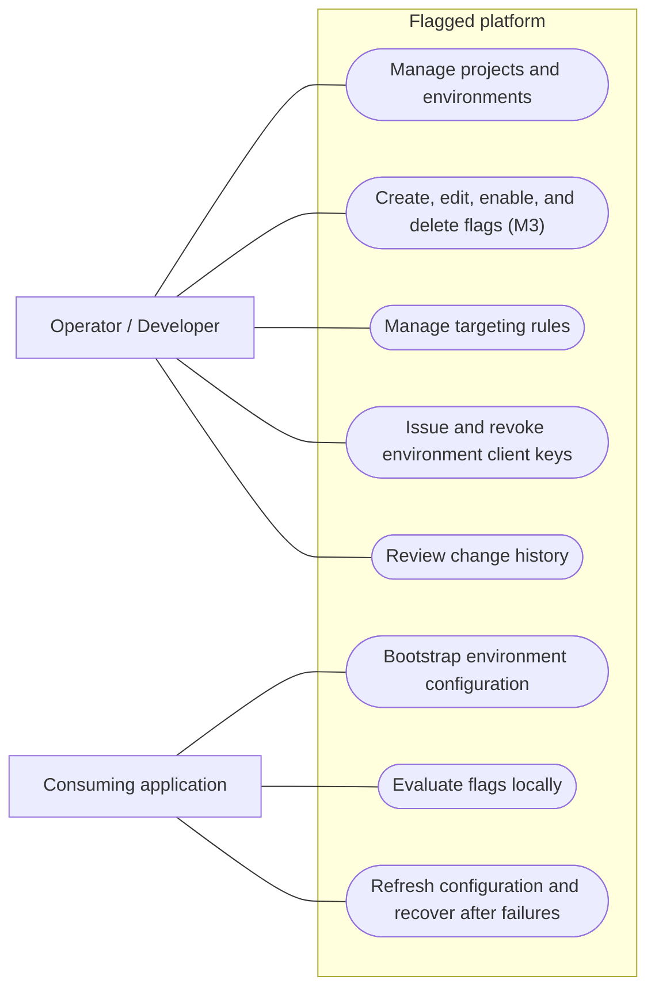
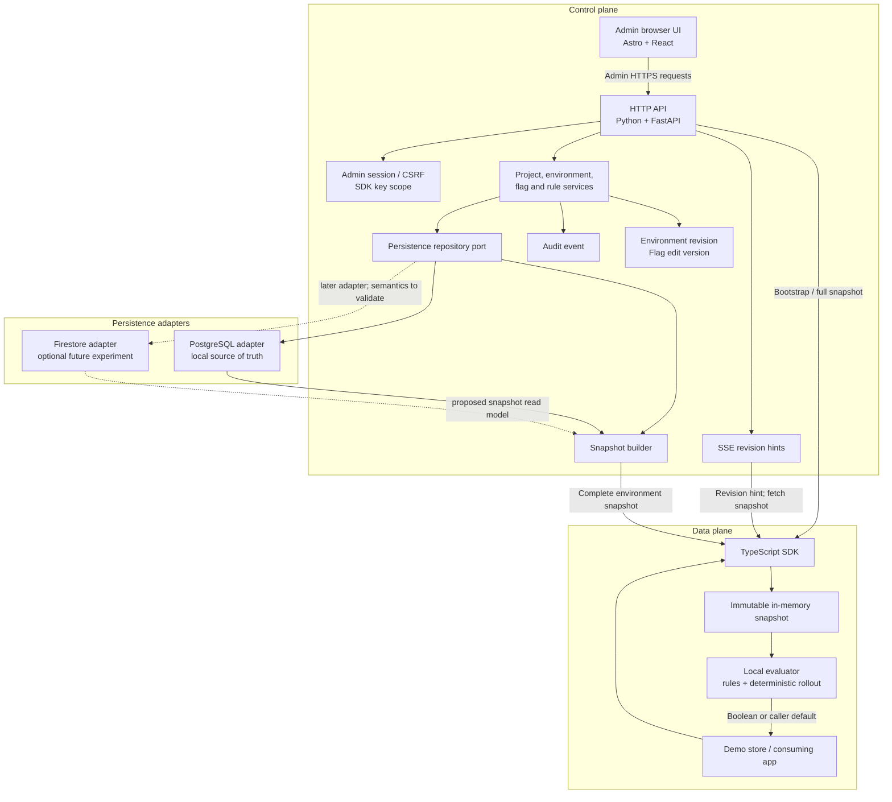
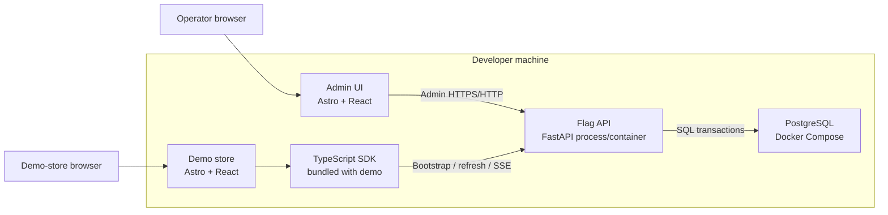
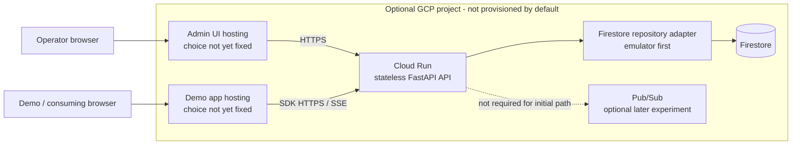
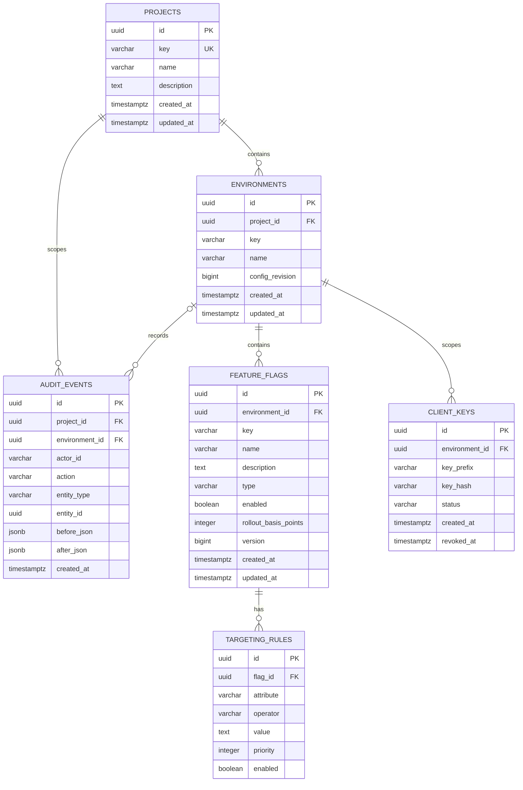

# Flagged technical design

**Status:** Planning draft; diagrams describe intended behavior, not verified implementation.

This document brings together the product use cases and the initial logical, physical,
data, and sequence views. It is a working design aid, not an architecture freeze. The
current contract sources are [PRD.md](../PRD.md), [ARCHITECTURE.md](../ARCHITECTURE.md),
[DATA.md](../DATA.md), [SYSTEM-DESIGN.md](../SYSTEM-DESIGN.md), and the draft
[API contract](API-CONTRACT.md). Related ADRs remain Proposed until implementation and
verification evidence exists.

## 1. Scope and modeling conventions

- The first useful product is a local feature-flag control plane, browser SDK, and demo
  store. The larger learning plan continues through all 12 milestones.
- The default development and validation path is local. No live cloud resources are
  required.
- Browser-visible SDK configuration is public. Client keys scope access; they do not
  make browser configuration confidential.
- Boolean flag evaluation is the first implementation target. Variant data and
  evaluation are not defined for the first milestone.
- Diagrams use Mermaid so the source remains reviewable in GitHub and alongside code.
  The use-case view uses a flowchart with actor and use-case shapes because Mermaid
  does not currently provide native UML use-case notation.

## 2. Product use cases

The primary actor is the single platform operator/developer. A consuming application
integrates the SDK; its end user is not an administrator and does not directly manage
flags.



### Use-case boundaries

- Admin operations require the proposed single-operator session and CSRF protections
  in ADR-018. SDK operations use an environment-scoped, read-only client key.
- Flag deletion is included in M3 feature-flag CRUD (FF-302), not a claim that it
  ships in the initial M1 foundation.
- The SDK evaluates against an immutable local snapshot and caller-provided context;
  normal evaluations do not call the API.
- On refresh failure, the SDK retains its last-known-good snapshot, or uses the
  caller's default if it has no valid snapshot.
- Targeting is not authorization. Protected application actions must be authorized
  by a trusted server.

## 3. Logical architecture

The control plane manages authoritative configuration; the data plane distributes
snapshots and evaluates locally. The API and persistence are shown as proposed
boundaries, not implemented modules.



### Logical invariants

1. The database is the control-plane source of truth; SDK memory is a cache.
2. A flag's `version` protects edits to that flag. An environment's `revision` orders
   complete SDK snapshots. They are separate counters.
3. Configuration mutation, revision increment, and audit event commit atomically.
   Bootstrap reads configuration and its revision from one consistent committed
   state.
4. The SDK installs only a valid snapshot with a strictly newer revision. It never
   discards its last-known-good snapshot because a refresh failed.
5. SSE events are revision hints, not configuration payloads. The SDK fetches a full
   snapshot after a hint and on reconnect.
6. The default local path does not require Redis, Pub/Sub, Firestore, or live GCP.

## 4. Physical architecture

### 4.1 Default local development topology

The local topology is the near-term implementation target. Exact package boundaries,
ports, health checks, and Compose service names will be documented when the local
foundation is implemented.



Redis is an optional local experiment, not a required dependency. The default
architecture uses PostgreSQL as the source of truth and the SDK's in-memory snapshot
as its local cache.

### 4.2 Optional cloud-learning topology

This view shows a possible later learning path, not an approved production design.
Frontend hosting, network configuration, identity/secret delivery, Firestore
transaction and projection behavior, and Cloud Run timeout settings still require
milestone-specific review.



Cloud Run, Firestore, and Pub/Sub remain optional architecture learning targets.
Firestore's proposed materialized SDK snapshot and its read/write cost must pass the
Firestore milestone gate before implementation. This diagram does not authorize
provisioning or imply a cost estimate.

## 5. Database schema view

This relationship diagram covers the proposed local PostgreSQL entities. Refer to
[DATA.md](../DATA.md) for canonical fields, types, constraints, revision rules, and
retention notes; do not treat this simplified view as a replacement schema. Variants
are intentionally omitted because their persisted model is not defined.



`config_revision` belongs to the environment, while `version` belongs to each flag.
The relationship notation does not specify delete cascades, indexes, or nullability;
those remain governed by [DATA.md](../DATA.md) and the eventual migrations. Full client
key secrets are returned once and never stored in plaintext.

ADR-019 requires environment keys never to be reused, but the tombstone/retention
mechanism is not yet defined. [DATA.md](../DATA.md) records this as an open schema
decision. Environment deletion is not exposed in the draft v1 API, so this diagram
does not invent a `deleted_at` column.

## 6. Sequence diagrams

### 6.1 Admin flag edit

The API contract and database transaction details are drafts. This sequence captures
the required atomicity and optimistic-concurrency behavior, not a verified call graph.

```mermaid
sequenceDiagram
    actor Operator
    participant UI as Admin UI
    participant API as FastAPI
    participant DB as Repository / database

    Operator->>UI: Edit flag with expectedVersion
    UI->>API: PATCH flag + session cookie + CSRF token
    API->>API: Validate session, Origin, CSRF, and request
    API->>DB: Begin transaction; load flag and environment
    DB-->>API: Current flag version and configuration
    alt expectedVersion is stale
        API-->>UI: 409 VERSION_CONFLICT
    else version matches
        API->>DB: Update flag and increment flag version
        API->>DB: Append audit event
        alt Client-visible configuration changed
            API->>DB: Increment environment revision
            Note over API,DB: Mutation, revision, and audit commit atomically
        else Admin-only metadata changed
            Note over API,DB: Commit mutation and audit without changing revision
        end
        API->>DB: Commit
        DB-->>API: Updated flag and environment revision
        API-->>UI: 200 updated flag + new version + revision
    end
```

Admin-only metadata changes do not increment the client-visible environment
revision. A failed or rolled-back transaction must not publish a new revision.

### 6.2 SDK bootstrap and local evaluation

```mermaid
sequenceDiagram
    actor App as Demo application
    participant SDK as TypeScript SDK
    participant API as SDK API
    participant DB as Repository / database

    App->>SDK: Initialize(project, environment, client key)
    SDK->>API: GET complete config + Authorization header
    API->>API: Authenticate key and verify environment scope
    API->>DB: Read revision, flags, and enabled rules consistently
    DB-->>API: One committed configuration state
    API-->>SDK: 200 snapshot(revision, flags)
    SDK->>SDK: Validate and atomically install snapshot
    SDK-->>App: Ready
    App->>SDK: isEnabled(flagKey, evaluation context)
    SDK->>SDK: Evaluate local snapshot; use fallback if unavailable
    SDK-->>App: Boolean result
```

An empty environment at revision `0` is a valid snapshot. A missing or invalid
bootstrap response does not become an installed snapshot; the SDK uses its documented
fallback behavior.

### 6.3 SDK refresh and stream recovery

```mermaid
sequenceDiagram
    participant SDK as TypeScript SDK
    participant API as SDK API / SSE
    participant DB as Repository / database

    SDK->>API: Open stream with installed revision baseline
    API->>DB: Check current environment revision
    DB-->>API: Current revision
    opt Baseline unknown or behind
        API-->>SDK: config.updated(revision)
        SDK->>API: GET complete config snapshot
        API->>DB: Read consistent snapshot
        DB-->>API: Snapshot and revision
        API-->>SDK: Full snapshot
        SDK->>SDK: Validate; install only if strictly newer
    end
    loop Stream active
        API->>DB: Poll environment revision
        DB-->>API: Current revision
        opt Revision advanced
            API-->>SDK: config.updated(revision)
            SDK->>API: GET complete config snapshot
            API-->>SDK: Full snapshot
            SDK->>SDK: Validate; install only if strictly newer
        end
    end
    Note over SDK,API: On disconnect or bounded lifetime, reconnect and fetch a full snapshot
```

The event carries only a revision hint, not flag data. The SDK keeps its last-known-good
snapshot during network or server failures and converges after recovery. Poll intervals,
timeouts, retries, and cloud read costs must be measured and reviewed for the adapter
being used.

## 7. Technical decision log

This is a navigation summary, not a substitute for the ADRs. All listed ADRs remain
**Proposed** until the corresponding implementation is delivered and verified.

| Concern | Current planning direction | Rationale / alternative considered | Source |
|---|---|---|---|
| Evaluation location | Evaluate locally in the SDK | Avoid a network round trip per evaluation; server-only evaluation is a future option for confidential rules | [ADR-008](adrs/ADR-008-local-evaluation.md), [ADR-022](adrs/ADR-022-sdk-payload-and-client-visible-fields.md) |
| Backend | Python + FastAPI | Matches the learning goals and provides typed HTTP service patterns; framework choice must be validated in implementation | [ADR-003](adrs/ADR-003-python-fastapi.md) |
| Local source of truth | PostgreSQL | Teaches relational modeling, constraints, migrations, and transactions; Firestore is a separate optional cloud-learning experiment | [ADR-005](adrs/ADR-005-postgresql-local.md), [ADR-006](adrs/ADR-006-firestore-cloud.md) |
| Persistence boundary | Repository interface with explicit adapters | Keeps domain logic from depending directly on database SDKs without pretending relational and document databases have identical semantics | [ADR-007](adrs/ADR-007-repository-abstraction.md) |
| Snapshot ordering | Environment revision plus per-flag edit version | Prevent stale SDK snapshots and lost admin edits with separate tokens for separate jobs | [ADR-019](adrs/ADR-019-configuration-version-semantics.md) |
| Rollout and rule ordering | Deterministic integer-basis-point rollout and stable rule precedence | Makes evaluations reproducible across SDK implementations; does not provide authorization or cryptographic security | [ADR-020](adrs/ADR-020-rule-precedence-and-rollout-bucketing.md) |
| Configuration propagation | Polling first, then SSE hints; Pub/Sub remains optional | Keeps the default path local and recoverable; a push bus adds infrastructure and delivery/idempotency work | [ADR-009](adrs/ADR-009-progressive-propagation.md), [ADR-021](adrs/ADR-021-sse-delivery-across-instances.md) |
| Admin authentication | **Proposed** — one operator with signed session cookie and CSRF protection; planned implementation is M3 / FF-304 | Avoid browser bearer-token storage, user/role infrastructure, and a hosted identity dependency at this scope. The ADR is not Accepted before implementation and verification. | [ADR-018](adrs/ADR-018-single-admin-authentication.md) |
| Browser payload | Complete environment snapshot; configuration is public | Enables offline local evaluation; sensitive rules must remain server-side and must not be sent to a browser | [ADR-022](adrs/ADR-022-sdk-payload-and-client-visible-fields.md) |
| Frontend and SDK | Astro + React dashboard/demo; TypeScript SDK | A cohesive browser-focused learning stack; the SDK's public API still needs implementation tests | [ADR-004](adrs/ADR-004-astro-react.md), [ADR-008](adrs/ADR-008-local-evaluation.md) |
| Cloud and infrastructure | GCP/Cloud Run and Terraform are optional learning targets; no default apply | Supports infrastructure learning while keeping the default path free of cloud charges | [ADR-001](adrs/ADR-001-local-first-cloud-later.md), [ADR-014](adrs/ADR-014-gcp-cloud-run.md), [ADR-015](adrs/ADR-015-terraform.md) |

### Open design work

- Review and reconcile the draft [API contract](API-CONTRACT.md) before backend work.
- Define and test exact PostgreSQL constraints, indexes, deletion behavior, and
  migration strategy with the API/data milestone.
- Decide whether the optional Firestore adapter needs a materialized snapshot and
  validate its consistency, size, revocation, and read/write-cost implications.
- Define variants only when their persisted schema, wire format, and evaluator are
  ready for a later milestone.
- Create operational runbooks and benchmarks alongside the failure and measurement
  work they describe; avoid claiming unmeasured production capacity.

## 8. Implementation documentation to add later

The template's installation commands, entry points, environment variables, error
handling, code conventions, and function-level examples should document actual
implementation, not a guessed design. Add these details to the README and code near
the relevant modules when the local application and SDK exist. Keep comments focused
on non-obvious behavior rather than duplicating function names or signatures.

## 9. Review and verification

Before implementation begins, review this draft with the relevant ADRs and
[architecture freeze gate](ARCHITECTURE-FREEZE-GATE.md). During implementation:

- update diagrams when an implemented boundary changes;
- link test or measurement evidence for behavior claims;
- keep proposed cloud topology and cost assumptions separate from the local default;
- do not change ADR status based on diagram review alone.
